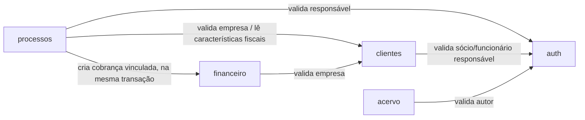

# Arquitetura do sistema SEIKA

> Documentação técnica do sistema reconstruído (pós `index.html`). Para o histórico de como era o
> sistema antigo, ver [`analise-sistema.md`](./analise-sistema.md). Para os fluxos passo a passo com
> diagramas de sequência, ver [`fluxos-e-diagramas.md`](./fluxos-e-diagramas.md).

## 1. Visão geral

O SEIKA é um **monolito modular**: um único backend (um processo, um banco de dados físico) organizado
internamente como se fossem vários serviços — cada módulo de negócio tem seu próprio **schema** dentro do
mesmo Postgres, e só pode acessar dados de outro módulo chamando a *função de serviço* dele, nunca lendo a
tabela diretamente. Essa disciplina é o que permite, no futuro, extrair qualquer módulo para um
microserviço de verdade sem reescrever a regra de negócio — a chamada de função vira uma chamada HTTP/fila,
e só isso muda.

**Stack:**

| Camada | Tecnologia |
|---|---|
| Backend | Node.js + TypeScript, [Fastify](https://fastify.dev) |
| Banco de dados | PostgreSQL 16, um schema por módulo, [Prisma ORM](https://www.prisma.io) (`multiSchema`) |
| Frontend | React + TypeScript (Vite), [TanStack Query](https://tanstack.com/query) pra estado de servidor |
| Autenticação | JWT de acesso (15 min) + refresh token opaco rotativo, cookie `httpOnly` |
| Infra de dev | Docker Compose (`postgres`, `backend`, `frontend`) |
| Testes de API | Collections Postman versionadas em `postman/collections/` (formato Git-nativo) |

## 2. Módulos (bounded contexts)

Cada módulo vive em `backend/src/modules/<nome>/` com a mesma estrutura interna: `types.ts` (validação
Zod), `repository.ts` (acesso ao Prisma), `service.ts` (regra de negócio) e `routes.ts` (endpoints HTTP).
Módulos maiores quebram `service.ts`/`repository.ts` em arquivos adicionais (ex: `obrigacoes-service.ts`,
`cobrancas-service.ts`) quando um sub-domínio cresce demais pra caber no arquivo principal.

| Módulo | Schema Postgres | Prefixo da API | Responsabilidade |
|---|---|---|---|
| `auth` | `auth` | `/api/v1/auth` | Identidade, login, sessão, RBAC |
| `clientes` | `clientes` | `/api/v1/empresas` | Cadastro de empresas-cliente (inclui parametrização fiscal) |
| `processos` | `processos` | `/api/v1/processos`, `/api/v1/obrigacoes` | Serviços prestados, obrigações (manuais e geradas), catálogo do Motor de Obrigações |
| `financeiro` | `financeiro` | `/api/v1/financeiro` | Cobranças, mensalidades, despesas, auditoria |
| `acervo` | `acervo` | `/api/v1/acervo` | Biblioteca interna (metadados + link externo) |

**Quem depende de quem** (chamada de serviço, nunca FK entre schemas):



Nenhuma seta tem volta: `clientes` e `auth` nunca importam nada de `processos`/`financeiro`/`acervo` — são
a base que os outros módulos consultam, não o contrário. Isso evita dependência circular entre módulos e
mantém cada um extraível de forma independente.

### 2.1 `auth` — Identidade

- `User` (id, name, email, passwordHash, role). `Role` = `SOCIO` \| `FUNCIONARIO` \| `CLIENTE` (só sócios e
  funcionários têm telas hoje — `CLIENTE` existe no enum pra quando houver portal do cliente).
- `RefreshToken` — token opaco (não-JWT), guardado só como hash SHA-256, com rotação a cada uso. Isso é o
  que permite *revogar* uma sessão de verdade (um JWT puro não dá pra revogar antes de expirar).
- Endpoints: `POST /login`, `POST /refresh`, `POST /logout`, `GET /me`, `PATCH /password`,
  `GET /users` (lista sócios/funcionários atribuíveis, usada nos dropdowns de responsável do resto do
  sistema).

### 2.2 `clientes` — Empresas

- `Empresa` — cadastro completo: dados básicos (razão social, CNPJ validado por dígito verificador,
  status), dados societários (natureza jurídica, porte, órgão de registro, capital social, inscrições,
  NIRE), endereço, certificado digital (**só link + data de vencimento** — o sistema nunca guarda o
  arquivo do certificado), e a **parametrização fiscal** que alimenta o Motor de Obrigações: regime
  tributário, apuração do Lucro Real, natureza da atividade e 15 características booleanas (`possuiX`,
  `contribuinteX`, `sujeitoX` — ver §4).
- `SocioAdministrador[]` e `Filial[]` — sub-entidades 1:N da empresa (filial exige CNPJ próprio e único).
- `Licenca[]` — alvarás/licenças com validade e status.

### 2.3 `processos` — Serviços e obrigações

Três conceitos distintos no mesmo schema:

1. **`Processo`** — um serviço vendido/prestado (ex: "Abertura de empresa"), com valor, desconto, prazo e
   uma **cobrança vinculada criada na mesma transação** (ver §5.2). Ciclo de vida: `StatusTarefa`
   (`A_FAZER` → `EM_ANDAMENTO`/`AGUARDANDO_CLIENTE` → `CONCLUIDO`).
2. **`Obrigacao`** — algo que precisa ser entregue até um prazo. Pode ser **manual** (cadastrada à mão,
   `templateId = null`) ou **gerada pelo Motor de Obrigações** (`templateId` aponta pro template que a
   originou, com `competencia`, `departamento`, `prazoLegal` e `semMovimento` preenchidos). Ciclo de vida
   próprio, `StatusObrigacao` (`AGUARDANDO_DOCUMENTOS` → `EM_ANALISE` → `EM_PROCESSAMENTO` →
   `EM_CONFERENCIA` → `CONCLUIDA`, ou `NAO_APLICAVEL`) — deliberadamente diferente do `StatusTarefa` do
   Processo, porque são ciclos de aprovação diferentes.
3. **`ObrigacaoTemplate`** — o catálogo de regras do Motor de Obrigações (ver §4). Não é uma obrigação em
   si, é a *regra* que, cruzada com o cadastro de uma empresa, decide se uma obrigação deve existir.

### 2.4 `financeiro` — Cobranças

- `Cobranca` — pode ser `ESPORADICO` (vinculada a um Processo), `MENSAL` (honorário recorrente) ou
  `AJUSTE`. Dinheiro sempre em **centavos inteiros** (nunca float), convertido pra reais só na borda da API
  (rota), nunca dentro do banco ou da regra de negócio.
- `Mensalidade` — configuração do honorário recorrente por empresa (valor, dia de vencimento, ativo). Não
  gera `Cobranca` automaticamente por cron — ver o padrão "virtual até alguém tocar" no §5.3.
- `Despesa` — custos da própria Seika.
- `AuditLogFinanceiro` — trilha append-only (por convenção de código; imutabilidade real a nível de banco
  fica pra quando houver credenciais de runtime separadas das de migration).

### 2.5 `acervo` — Biblioteca interna

- `MaterialAcervo` — só metadados (título, área, tipo, categoria, descrição) + um link externo (geralmente
  Google Drive). **Decisão de segurança deliberada**: o sistema nunca armazena nem transporta o arquivo em
  si — zero credencial de storage de terceiro guardada na aplicação. Acessível igualmente pelos 3 sócios,
  sem permissão granular (regra de negócio explícita).

## 3. Autenticação e autorização

- **Login**: `POST /auth/login` com email+senha (bcrypt). Devolve um **access token JWT** (15 min,
  assinado com `JWT_SECRET`) no corpo da resposta, e um **refresh token opaco** num cookie `httpOnly` +
  `secure` (em produção) + `sameSite=lax`.
- **Refresh**: quando o access token expira, o frontend chama `POST /auth/refresh` automaticamente (ver
  `useApiClient.ts`) — o backend valida o hash do refresh token, **revoga o antigo e emite um novo**
  (rotação a cada uso). Isso significa que um refresh token roubado só funciona uma vez antes de ser
  invalidado pelo uso legítimo seguinte.
- **Autorização**: todo módulo (exceto `/auth` em si) usa os `preHandler`s `requireAuth` +
  `requireRole("SOCIO", "FUNCIONARIO")` — hoje só sócio e funcionário têm acesso, não existe ainda
  autoatendimento de cliente.

## 4. O Motor de Obrigações

Implementa a "Cartilha de Obrigações dos Clientes" como um motor de regras: dado o regime tributário, a
natureza da atividade e as características de uma empresa, decide quais obrigações (fiscais, pessoais,
contábeis) se aplicam, com periodicidade, prazo legal e prazo interno.

**Entrada** (cadastro da `Empresa`, módulo `clientes`):
- `regimeTributario` (Simples Nacional / Lucro Presumido / Lucro Real) + `lucroRealApuracao` quando Real.
- `naturezaAtividade` (Serviço / Comércio / Mista).
- 15 booleanos: `possuiEmpregados`, `possuiProLabore`, `possuiAutonomosRpa`, `contribuinteIcms`,
  `contribuinteIss`, `contribuinteIpi`, `possuiIcmsSt`, `possuiDifal`, `possuiAntecipacaoTributaria`,
  `possuiRetencoesFederais`, `possuiRetencaoInss`, `possuiRetencaoIss`, `possuiCprb`, `sujeitoFatorR`,
  `possuiSstObrigatorio`.

**Catálogo** (`ObrigacaoTemplate`, módulo `processos`): cada regra guarda, entre outros campos, os mesmos
15 booleanos com prefixo `exigeX` (`exigeEmpregados`, `exigeIcms`, ...) — "exige" = só habilita se a
empresa também tiver essa característica marcada. Hoje o catálogo tem **39 regras**, transcritas da
cartilha (seções 3.1 a 5.3), todas revisadas ao construir o motor mas que ainda merecem conferência humana
de um sócio antes de confiar cegamente nos prazos — o próprio catálogo tem um campo `ativo` pra publicar
regra por regra.

**Motor** (`obrigacoes-gerador-service.ts`): cruza cada empresa ativa com cada template ativo. Uma regra
"aplica" quando: regime bate, atividade bate, (se Lucro Real) a apuração bate, a vigência da regra cobre a
data de hoje, e **todo** `exigeX = true` do template corresponde a um `possuiX = true` da empresa. Se
aplicar e o mês da competência estiver em `mesesCompetencia`, o motor materializa uma `Obrigacao` com prazo
legal (dia-base + meses após a competência) e prazo interno (prazo legal menos alguns dias de antecedência)
calculados automaticamente. Uma chave única (`chaveGeracao`) garante que rodar o motor de novo nunca
duplica o que já foi gerado.

**Saída**: as obrigações geradas aparecem nas mesmas telas das obrigações manuais — Central de Prazos,
Central de Pendências e Kanban Operacional — sem view separada.

> O fluxo completo, passo a passo, está no diagrama de sequência "Motor de Obrigações" em
> [`fluxos-e-diagramas.md`](./fluxos-e-diagramas.md).

## 5. Padrões recorrentes no backend

### 5.1 Dinheiro em centavos

Todo valor monetário é um `Int` em centavos no banco e na regra de negócio (`toCentavos`/`fromCentavos` em
`shared/money.ts`). A conversão pra reais só acontece na camada de rota, na resposta da API — nunca antes.
Isso elimina os bugs de arredondamento de ponto flutuante que existiam no sistema antigo.

### 5.2 Transação atômica entre módulos

Quando uma ação precisa gravar em mais de um módulo ao mesmo tempo (ex: criar um `Processo` E a `Cobranca`
vinculada), o service do módulo "dono" da ação abre uma `prisma.$transaction` e passa o `tx` adiante pras
funções do outro módulo, que aceitam um parâmetro opcional `db: Db = prisma` pra participar da mesma
transação em vez de abrir a própria conexão. Isso garante que os dois gravam juntos ou nenhum grava — sem
isso, bastaria a chamada ao segundo módulo falhar pra deixar o primeiro "pendurado".

### 5.3 "Virtual até alguém tocar"

Usado pra mensalidades recorrentes (`cobrancas-service.ts`): a cobrança do mês corrente não existe como
linha no banco até alguém de fato interagir com ela (pagar, estornar). Até lá, ela aparece nas listagens
como um objeto **virtual** (`id` no formato `virtual:<chave>`), calculado na hora. Isso evita precisar de um
cron job só pra "criar a cobrança todo dia 1º" — o cálculo é feito sob demanda, e só vira registro real
quando alguém realmente usa aquela cobrança. (O Motor de Obrigações **não** usa esse padrão — como gerar
obrigações já é uma ação explícita do sócio, o motor materializa direto, é idempotente por chave única.)

### 5.4 Status computado, nunca gravado

"Atrasado" (de uma cobrança) e "prazo vencido" (de uma obrigação, legal ou interno) nunca são um valor
salvo no banco — são calculados comparando a data gravada com a data de hoje, no momento da resposta
(backend, caso da Cobrança) ou da renderização (frontend, caso da Obrigação). Guardar isso como coluna
exigiria um job rodando todo dia só pra manter em dia; calculado na hora, está sempre certo.

## 6. Frontend

SPA React com rotas protegidas (`ProtectedRoute`) e um layout único (`AppLayout`) com menu lateral
dividido em seções. Cada tela consome a API via `useApiClient` (wrapper de `fetch` com renovação
automática de token em 401) e `@tanstack/react-query` pra cache/estado de servidor.

| Rota | Tela | Módulo backend |
|---|---|---|
| `/` | Dashboard (agregados de todos os módulos) | vários |
| `/meu-espaco` | Processos/obrigações do usuário logado | `processos` |
| `/clientes`, `/clientes/:id` | Cadastro de empresas | `clientes` |
| `/obrigacoes` | Central de Prazos (+ botão "Gerar obrigações do mês") | `processos` |
| `/obrigacoes/pendencias` | Central de Pendências (por urgência) | `processos` |
| `/obrigacoes/templates` | Catálogo de obrigações (admin do Motor) | `processos` |
| `/processos` | Kanban de serviços prestados | `processos` |
| `/operacional` | Kanban por sócio (processos + obrigações) | `processos` |
| `/legalizacao` | Licenças a vencer + gerador de minuta (100% client-side) | `clientes` |
| `/financeiro` | Cobranças, mensalidades, despesas, auditoria | `financeiro` |
| `/acervo` | Biblioteca interna | `acervo` |
| `/ferramentas` | Atalhos pra ferramentas externas (estático) | — |

## 7. Como rodar localmente

```bash
docker compose up -d                 # sobe postgres + backend + frontend
docker compose exec backend npx prisma migrate deploy   # aplica migrations
```

- Backend: http://localhost:3001 (mapeado de `3000` dentro do container)
- Frontend: http://localhost:5173
- Postgres: `localhost:5432` (usuário/senha/banco `seika`)

Hot-reload de backend e frontend usa polling (`nodemon --legacy-watch` / `vite` com
`watch.usePolling`) porque bind mounts do Docker no Windows não propagam eventos `inotify` nativos.

Testes de API: `postman collection run "postman/collections/<Nome>" --environment
postman/environments/Local.environment.yaml --env-var access_token=<token>` (o token precisa ser passado
assim porque `pm.environment.set` não persiste em disco entre execuções separadas da CLI).
