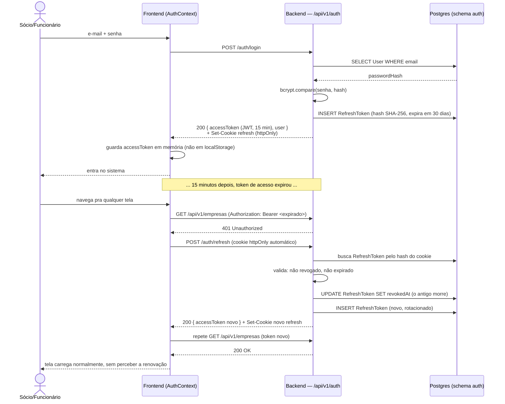
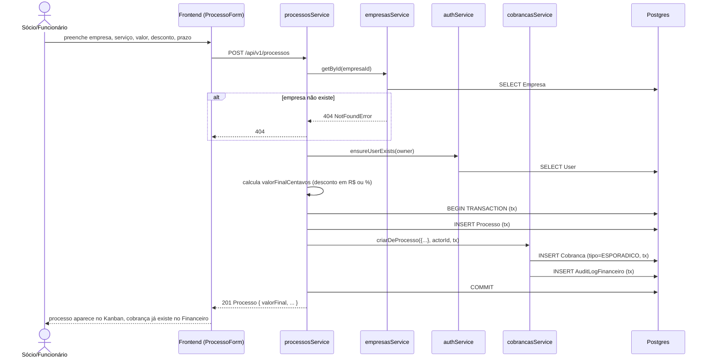
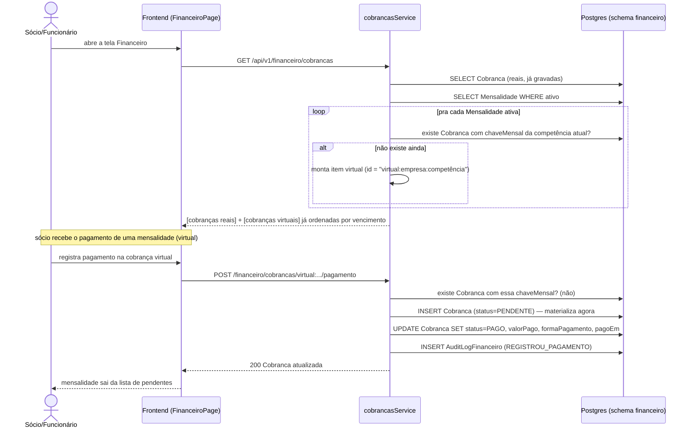
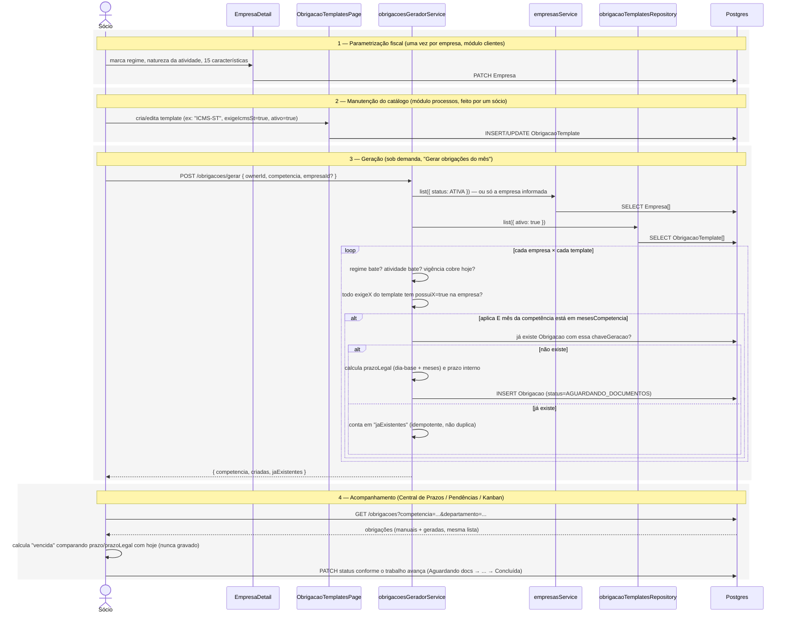
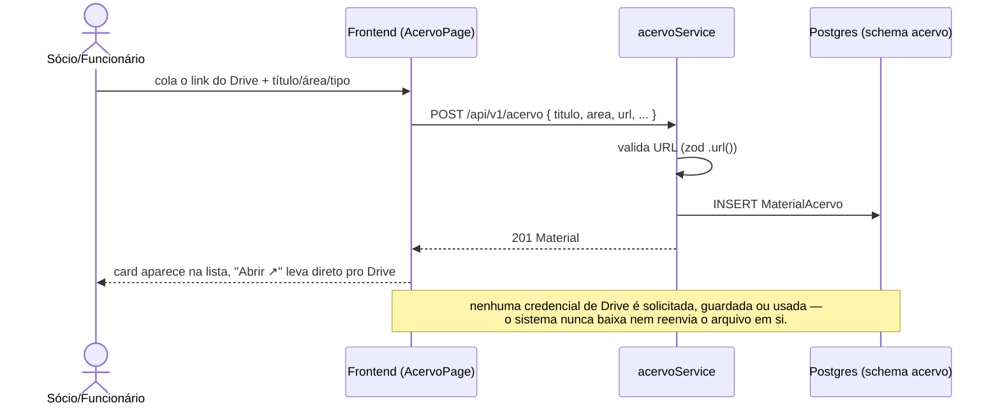

# Fluxos e diagramas de sequência

> Diagramas em [Mermaid](https://mermaid.js.org) — renderizam direto no GitHub e em extensões de preview
> de Markdown do VSCode. Complementa [`arquitetura.md`](./arquitetura.md), que explica os módulos e
> padrões; aqui o foco é "o que acontece, passo a passo" nos fluxos mais importantes do sistema.

## 1. Login e renovação automática de sessão

O frontend nunca deixa o usuário "cair" por o token de acesso ter expirado — a renovação acontece sozinha,
no meio de qualquer requisição que tome um 401.

Se o refresh token também estiver inválido/expirado (ex: `logout` em outro dispositivo, ou 30 dias sem
uso), o segundo passo falha e o frontend redireciona pro login.

## 2. Criar um serviço (Processo) com cobrança vinculada

A garantia importante aqui é **atomicidade**: ou o Processo e a Cobrança são gravados juntos, ou nenhum dos
dois é gravado.

Se `criarDeProcesso` lançar qualquer erro depois do `INSERT Processo`, a transação inteira é desfeita — não
existe cenário de "processo criado mas sem cobrança".

## 3. Mensalidade: cobrança virtual até o pagamento

Honorários recorrentes não geram uma linha no banco todo mês via cron — a cobrança do mês corrente só é
calculada quando alguém olha a lista, e só vira registro de verdade quando alguém a paga ou estorna.

## 4. Motor de Obrigações — do cadastro à Central de Pendências

O fluxo mais longo do sistema: três momentos separados (parametrizar a empresa, manter o catálogo, rodar o
motor) que convergem na mesma tela de trabalho.

Rodar o passo 3 de novo (ex: todo início de mês) é seguro — a chave única (`chaveGeracao`) impede
duplicação, então só as obrigações realmente novas daquela competência são criadas.

## 5. Biblioteca interna (Acervo) — link, nunca arquivo

Fluxo deliberadamente simples, sem upload nem OAuth:

